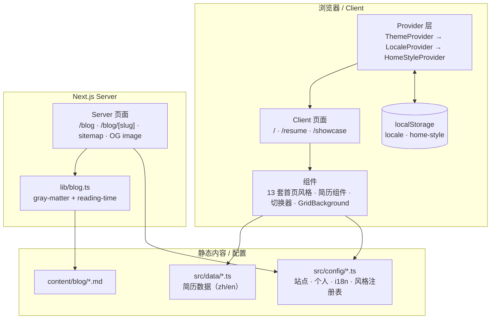
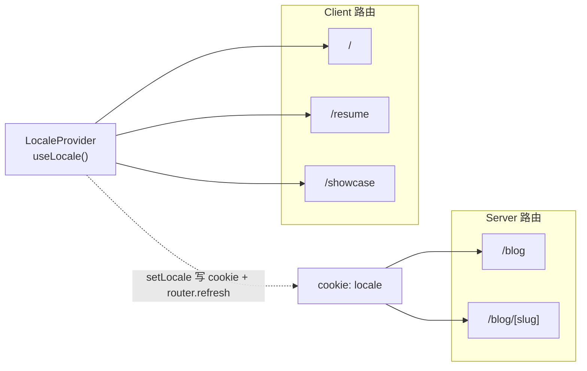
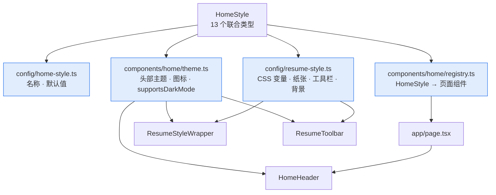
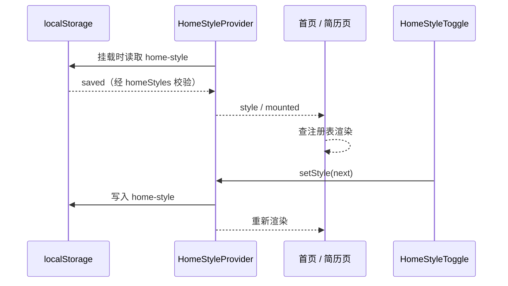
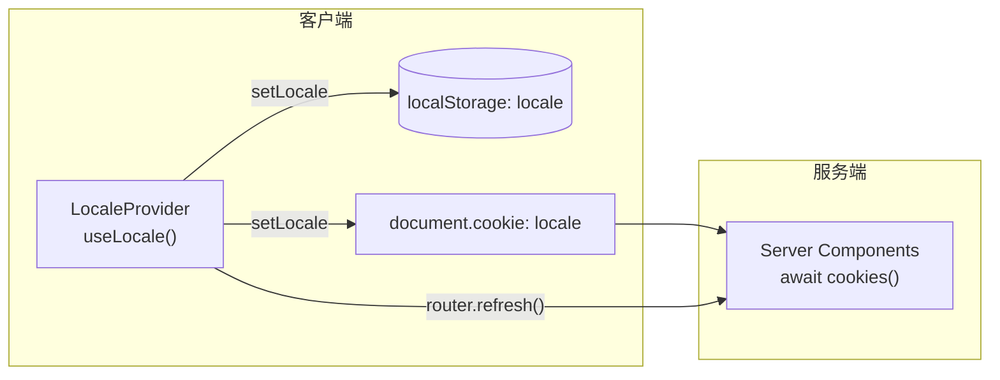
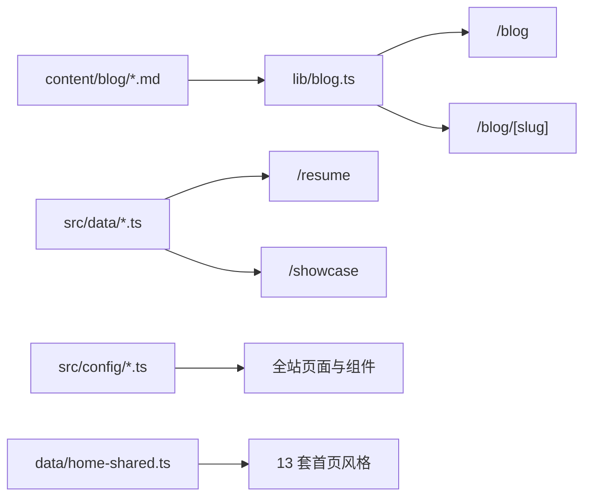
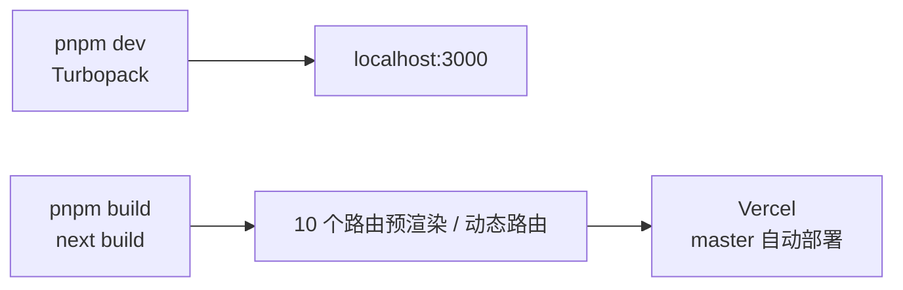

# 项目架构

> 本文档描述当前（风格注册表重构后）的架构。图使用 Mermaid，GitHub / GitLab 可直接渲染，VS Code 需安装 Mermaid 预览插件。

## 视觉版架构图

以下三张图使用 diagram-design 生成（站点品牌浅色：纸色 `#FAF8F5` / 墨色 `#1A1A1A` / 砖红 `#C44536`），可直接用浏览器打开：

- [系统分层总览](./diagrams/architecture-overview.html)
- [首页风格注册表](./diagrams/architecture-style-registry.html)
- [运行时状态与数据流](./diagrams/architecture-data-flow.html)

## 1. 分层总览

## 2. 路由与 Server / Client 边界

| 路由 | 类型 | 语言来源 | 数据来源 |
|---|---|---|---|
| `/` | Client | `useLocale()` | `config/` + `data/home-shared.ts` |
| `/resume` | Client | `useLocale()` | `data/*.ts` + `config/resume-style.ts` |
| `/showcase` | Client | `useLocale()` | `data/projects.ts` |
| `/blog` | Server | `await cookies()` | `content/blog/*.md` |
| `/blog/[slug]` | Server | `await cookies()` | `content/blog/*.md` |
| `/sitemap.xml` | Server | 无 | 静态路由 + 博客文件 |
| `/opengraph-image` | Server | 无 | `config/site.ts` |

## 3. 首页风格系统（四处穷举注册表）

新增一种风格需要同时补齐四处 `Record<HomeStyle, ...>` 与一个组件文件；任意一处漏写都会在编译期报错，不会静默降级。

### 13 种风格与能力位

| 风格 | 组件 | 明暗切换 |
|---|---|---|
| tech / minimal | 使用语义 CSS 变量 | ✅ |
| terminal / chinese / magazine / bauhaus / retro / glass / f1 / brutalist / synthwave / japanese / newspaper | 固定配色 | ❌ |

固定配色风格不响应 `dark` class，因此 `supportsDarkMode` 为 `false`，首页头部与简历工具栏都会隐藏明暗按钮。

## 4. 风格状态与持久化

`home-style` 只有 `HomeStyleProvider` 一个读写入口，页面与工具栏都通过 `useHomeStyle()` 消费，不再使用 `CustomEvent` 同步。

## 5. i18n 双轨制

- Client 组件：`useLocale()` 读 Context，切换时双写 `localStorage` + cookie。
- Server 组件：`cookies()` 读同一份 cookie，`router.refresh()` 触发重新渲染。
- 默认语言：`zh`。

## 6. 内容与数据流

- 博客：文件系统读取，`gray-matter` 解析 frontmatter，`reading-time` 估算时长，`react-markdown` 渲染。
- 简历 / 展示：共用 `src/data/projects.ts`，保证两处内容一致。
- 没有 API 层、数据库或运行时后端，内容在构建期确定。

## 7. 关键模块职责

| 模块 | 职责 |
|---|---|
| `src/app/layout.tsx` | 挂载 ThemeProvider → LocaleProvider → HomeStyleProvider |
| `src/app/page.tsx` | 读 `useHomeStyle()`，查 `HOME_STYLE_COMPONENTS` 渲染 |
| `src/components/home/registry.ts` | `HomeStyle → 页面组件` 穷举映射 |
| `src/components/home/theme.ts` | 头部主题、图标、明暗能力位 |
| `src/components/home/home-header.tsx` | 首页公共头部（风格切换 / 语言 / 明暗） |
| `src/config/home-style.ts` | 风格联合类型、名称、默认值 |
| `src/config/resume-style.ts` | 简历 CSS 变量、纸张、工具栏配色、背景 key |
| `src/components/resume-style-wrapper.tsx` | 简历页套壳，注入 CSS 变量与背景 |
| `src/components/resume/resume-backgrounds.tsx` | 按风格渲染背景装饰 |
| `src/contexts/home-style-context.tsx` | 风格的唯一 localStorage 读写入口 |
| `src/contexts/locale-context.tsx` | 语言 Context + cookie 双写 |
| `src/lib/blog.ts` | 博客文件读取与 frontmatter 解析 |

## 8. 新增一种首页风格

1. `src/config/home-style.ts`：加入 `HomeStyle` 联合类型与 `homeStyles` 名称。
2. `src/components/home/xxx-style.tsx`：实现 `{ locale, header }` 组件。
3. `src/components/home/registry.ts`：登记组件映射。
4. `src/components/home/theme.ts`：登记头部主题、图标、`supportsDarkMode`。
5. `src/config/resume-style.ts`：登记简历 CSS 变量、纸张、工具栏、背景。

第 1、3、4、5 步都是穷举 `Record<HomeStyle, ...>`，漏写会直接编译失败。

## 9. 构建与部署

